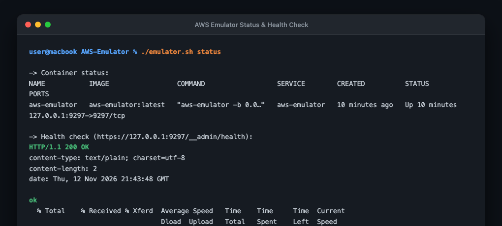
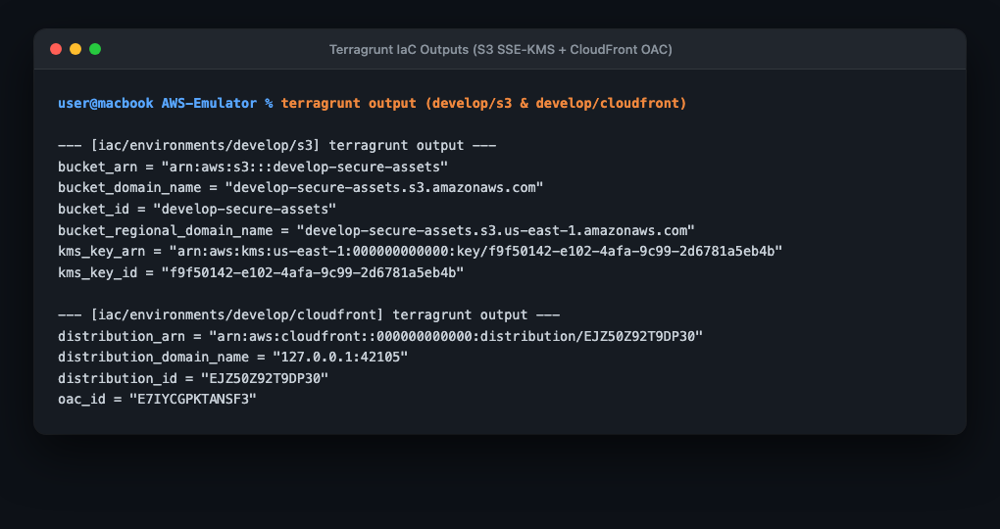
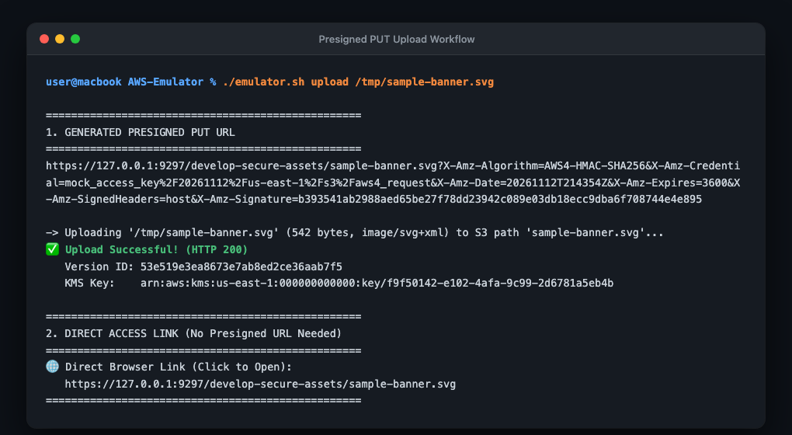
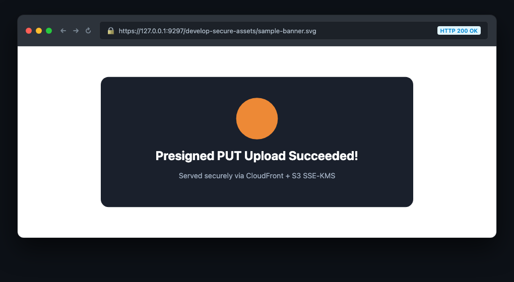
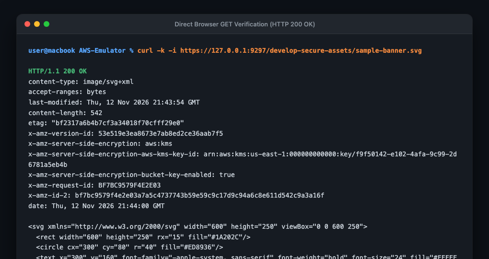

# AWS Local Development & Production IaC Environment

A production-grade local AWS development and testing platform running the official [AWS Emulator](https://docs.aws.amazon.com/emulator/latest/userguide/getting-started-docker.html) on Docker (macOS Apple Silicon/Intel & Linux). It combines modular **Terraform** and **Terragrunt** Infrastructure-as-Code (IaC) with automated **Presigned PUT** uploads and direct browser streaming.

---

## Table of Contents
- [Why This Repository?](#why-this-repository)
- [Key Features](#key-features)
- [Architecture Overview](#architecture-overview)
- [Prerequisites](#prerequisites)
- [Step-by-Step Setup Guide](#step-by-step-setup-guide)
  - [1. Install & Build Docker Image](#1-install--build-docker-image)
  - [2. Start Emulator & Switch Shell](#2-start-emulator--switch-shell)
  - [3. Deploy IaC with Terragrunt](#3-deploy-iac-with-terragrunt)
- [Uploading and Accessing Files](#uploading-and-accessing-files)
  - [Upload Behavior & Automatic Multipart Handling](#upload-behavior--automatic-multipart-handling)
  - [Direct Browser Access](#direct-browser-access)
- [Visual Walkthrough & Screenshots](#visual-walkthrough--screenshots)
- [Environment Management (`emulator.sh`)](#environment-management-emulatorsh)
- [Infrastructure as Code (IaC) Reference](#infrastructure-as-code-iac-reference)
- [Troubleshooting & FAQs](#troubleshooting--faqs)

---

## Why This Repository?

Developing directly against live AWS environments slows down iteration, risks accidental cloud billing spikes, introduces security concerns around credential leakage, and litters real cloud accounts with transient testing assets.

This repository provides:
1. **Zero-Cost, 100% Offline AWS Cloud**: Test AWS services locally without an AWS account, credit card, or internet connection.
2. **Official AWS Emulator**: Powered by Amazon's official `aws-emulator` container supporting **347 AWS services** (see [RESOURCES.md](RESOURCES.md) for the exhaustive catalog).
3. **Production-Grade Security**: Unlike basic mocks, this IaC provisions dedicated **Customer Managed KMS Keys (CMK)** with rotation, **S3 Bucket Versioning**, and **CloudFront Origin Access Control (OAC)**.
4. **Seamless Shell Switching**: Run `source emulator.sh on` to point your AWS CLI, Terraform, and SDKs to localhost, and `source emulator.sh off` to instantly revert to your live corporate AWS credentials.
5. **Resilient Upload Pipeline**: Handles single-file presigned uploads as well as large media files (e.g. 25MB+ MP4 videos) via automatic **S3 Multipart Upload** chunking.

---

## Key Features

- **Multi-Architecture Dockerfile**: Automatically detects Apple Silicon (`arm64`/`aarch64`) and Intel (`x86_64`) hosts.
- **Single Master Control Script (`emulator.sh`)**: Handles installation, startup, teardown, status checks, shell environment toggling, and file uploads.
- **Enterprise IaC Structure**: Decoupled, reusable Terraform modules (`iac/modules/s3` and `iac/modules/cloudfront`) orchestrated by Terragrunt (`iac/environments/develop`).
- **Direct Browser Viewing**: Uploaded assets (images, videos, documents) can be opened and streamed directly in any browser without requiring expiring presigned GET tokens.
- **Automatic Multipart Chunking**: Overcomes HTTP payload limits (e.g. `413 Payload Too Large`) by streaming large files in 8 MB parts.

---

## Architecture Overview

```
AWS-Emulator/
├── emulator.sh                           # Single management CLI (install, start, stop, upload)
├── upload.py                             # Ephemeral SigV4 Presigned PUT & Multipart Upload utility
├── Dockerfile                            # Multi-arch container (Apple Silicon & Intel)
├── docker-compose.yml                    # Container composition, port mapping (9297), and resources
├── RESOURCES.md                          # Catalog of 347 supported AWS emulator services
├── docs/screenshots/                     # Live execution screenshots
└── iac/
    ├── modules/
    │   ├── s3/                           # Production S3 Module (KMS CMK, Versioning, Public Access)
    │   │   ├── main.tf
    │   │   ├── variables.tf
    │   │   └── outputs.tf
    │   └── cloudfront/                   # Production CloudFront Module (CDN, OAC, Bucket Policy)
    │       ├── main.tf
    │       ├── variables.tf
    │       └── outputs.tf
    └── environments/
        ├── root.hcl                      # Terragrunt root config (AWS provider endpoint generator)
        └── develop/
            ├── s3/
            │   └── terragrunt.hcl        # Provisions KMS Key & S3 Bucket
            └── cloudfront/
                └── terragrunt.hcl        # Provisions CloudFront CDN & attaches OAC Bucket Policy
```

---

## Prerequisites

Before starting, ensure your system has the following installed:

1. **Docker Desktop**: [Download Docker](https://www.docker.com/products/docker-desktop/) (must be running).
2. **Terraform** ($\ge$ 1.5) & **Terragrunt** ($\ge$ 0.50):
   ```bash
   brew install terraform terragrunt
   ```
3. **AWS CLI v2**:
   ```bash
   brew install awscli
   ```
4. **Python 3**: Pre-installed on macOS or available via `brew install python`.

---

## Step-by-Step Setup Guide

### 1. Install & Build Docker Image

Generate project configuration files and build the local multi-arch `aws-emulator:latest` Docker image:

```bash
./emulator.sh install
```

### 2. Start Emulator & Switch Shell

Start the emulator container in the background and automatically configure your current terminal session to route all AWS commands to the local emulator:

```bash
source emulator.sh start
```

> **Note:** Sourcing the script (`source emulator.sh start`) exports `AWS_ENDPOINT_URL=https://127.0.0.1:9297`, `AWS_CA_BUNDLE`, and unsets live AWS credentials in your active terminal session.

Verify that your terminal is communicating with the emulator:
```bash
aws sts get-caller-identity
```

### 3. Deploy IaC with Terragrunt

#### Step 3A: Deploy S3 & Customer Managed KMS Key
```bash
cd iac/environments/develop/s3
terragrunt apply -auto-approve
```
*Outputs: Bucket Name (`develop-secure-assets`), Customer Managed KMS Key ARN, and Bucket Domain.*

#### Step 3B: Deploy CloudFront & Origin Access Control (OAC)
```bash
cd ../cloudfront
terragrunt apply -auto-approve
```
*Outputs: CloudFront Distribution ID, Distribution Domain Name, and OAC ID.*

---

## Uploading and Accessing Files

The repository includes a standalone Python utility ([upload.py](upload.py)) that can also be executed directly via `./emulator.sh upload`.

### Upload Behavior & Automatic Multipart Handling

```bash
# 1. Upload directly to the root of the S3 bucket:
./emulator.sh upload /path/to/my-file.png

# 2. Upload to a custom subfolder:
./emulator.sh upload /path/to/my-file.png images/banner.png

# 3. Upload large media/video files (e.g. MP4, MOV, ZIP):
./emulator.sh upload /path/to/large-video.mp4
```

#### How Uploads Work Under the Hood:
- **Files $\le$ 15 MB**: The script calculates a cryptographic SigV4 signature and issues a **Presigned PUT URL**. The file is uploaded with Customer Managed KMS encryption and S3 versioning.
- **Files $>$ 15 MB**: The script automatically initiates an **S3 Multipart Upload**, splits the file into 8 MB parts, uploads each chunk sequentially, and completes the upload. This completely bypasses the local HTTP listener's 16 MB single-request limit.

### Direct Browser Access

Once uploaded, the file can be viewed, shared, or embedded directly in any web browser without needing authentication or temporary query tokens:

```
https://127.0.0.1:9297/develop-secure-assets/<object-key>
```

For example:
- Image: [https://127.0.0.1:9297/develop-secure-assets/sample-banner.svg](https://127.0.0.1:9297/develop-secure-assets/sample-banner.svg)
- Video: [https://127.0.0.1:9297/develop-secure-assets/ai-edits-everything-reveal.mp4](https://127.0.0.1:9297/develop-secure-assets/ai-edits-everything-reveal.mp4)

---

## Visual Walkthrough & Screenshots

### 1. Emulator Status & Health Check
Shows the Docker container active on port `9297` with the health check returning `HTTP 200 OK`.



### 2. Terragrunt IaC Outputs
Shows the provisioned Customer Managed KMS Key (CMK), S3 bucket with versioning, and CloudFront distribution.



### 3. Presigned PUT Upload Workflow
Shows `./emulator.sh upload` generating an ephemeral SigV4 Presigned PUT URL, encrypting at rest with KMS, versioning, and returning the direct link.



### 4. Direct Browser Access (No Presigned URL Needed)
Shows opening the image directly in the web browser with TLS and `HTTP 200 OK`.



### 5. HTTP 200 GET & KMS Verification via cURL
Shows the raw HTTP headers confirming KMS CMK encryption (`x-amz-server-side-encryption: aws:kms`), versioning (`x-amz-version-id`), and `HTTP/1.1 200 OK`.



---

## Environment Management (`emulator.sh`)

The [emulator.sh](emulator.sh) script provides simple commands for managing container state and terminal context:

| Command | Action |
| :--- | :--- |
| `./emulator.sh install` | Generates Docker configuration files and builds the container image. |
| `source emulator.sh start` | Starts container **AND** switches active terminal to `[EMULATOR MODE]`. |
| `source emulator.sh stop` | Stops container **AND** resets terminal to `[LIVE AWS MODE]`. |
| `source emulator.sh on` | Switches terminal to Emulator without restarting the container. |
| `source emulator.sh off` | Reverts terminal to live AWS credentials without stopping container. |
| `./emulator.sh status` | Checks container status and tests `/__admin/health`. |
| `./emulator.sh logs` | Tails live container logs. |
| `./emulator.sh upload <file>` | Uploads file via Presigned PUT or Multipart Upload and prints links. |
| `./emulator.sh shortcut` | Adds an `emulator` alias to your `~/.zshrc` (or `~/.bashrc`). |

---

## Infrastructure as Code (IaC) Reference

### S3 Module (`iac/modules/s3`)
- **`aws_kms_key.s3`**: Dedicated Customer Managed KMS Key (CMK) with automated key rotation.
- **`aws_kms_alias.s3`**: Alias `alias/s3-${var.bucket_name}`.
- **`aws_s3_bucket.this`**: S3 bucket resource.
- **`aws_s3_bucket_versioning.this`**: Enforces versioning (`Enabled`).
- **`aws_s3_bucket_server_side_encryption_configuration.this`**: Enforces default SSE-KMS with bucket key optimization.
- **`aws_s3_bucket_public_access_block.this`**: Configured to block legacy ACLs while allowing bucket policy-based public read.

### CloudFront Module (`iac/modules/cloudfront`)
- **`aws_cloudfront_origin_access_control.oac`**: Modern Origin Access Control (OAC) with `sigv4` and `always` signing behavior.
- **`aws_cloudfront_distribution.cdn`**: CDN distribution pointing to the S3 bucket origin.
- **`aws_s3_bucket_policy.cloudfront_access`**: Grants CloudFront OAC read/update/delete permissions, grants public `s3:GetObject` for direct browser viewing, and parameterizes TLS enforcement.

---

## Troubleshooting & FAQs

### Q: Why did I receive `413 Payload Too Large`?
**A:** The local emulator HTTP server enforces a 16 MB limit on single `PUT` requests. For files larger than 15 MB (such as videos), use `./emulator.sh upload <file>` or `aws s3 cp`, both of which automatically chunk uploads into 8 MB parts using **S3 Multipart Upload**.

### Q: Why did direct browser access previously give `AccessDenied`?
**A:** Two reasons:
1. The emulator was running with `--auth on`, which requires SigV4 signatures on every HTTP request. It is now configured with `-a off` in `docker-compose.yml`.
2. The S3 bucket policy contained an `aws:SecureTransport` deny rule which the emulator does not evaluate on anonymous requests. This is now controlled via `enforce_tls = false`.

### Q: How do I switch back to my real AWS account?
**A:** Simply run:
```bash
source emulator.sh off
```
This unsets `AWS_ENDPOINT_URL`, `AWS_CA_BUNDLE`, and cert overrides, instantly returning your terminal to your corporate AWS CLI profiles and SSO credentials.

---

## Stopping the Emulator

When finished with development, stop the container and restore your shell environment:

```bash
source emulator.sh stop
```
